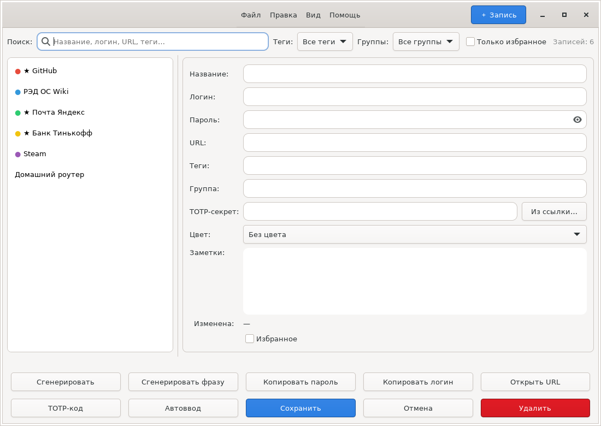
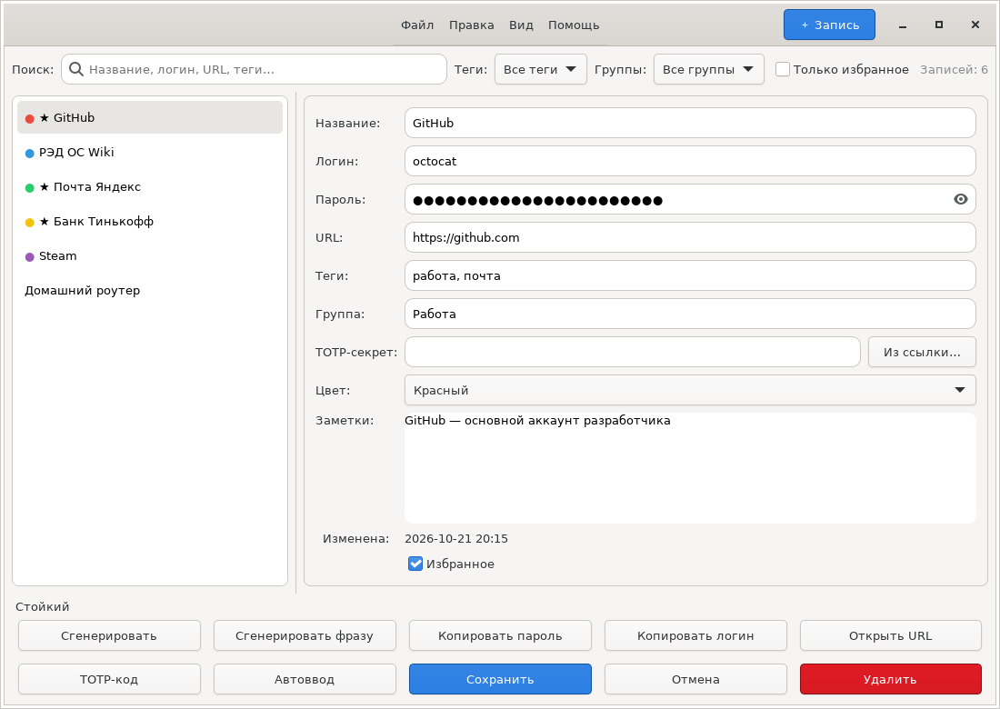
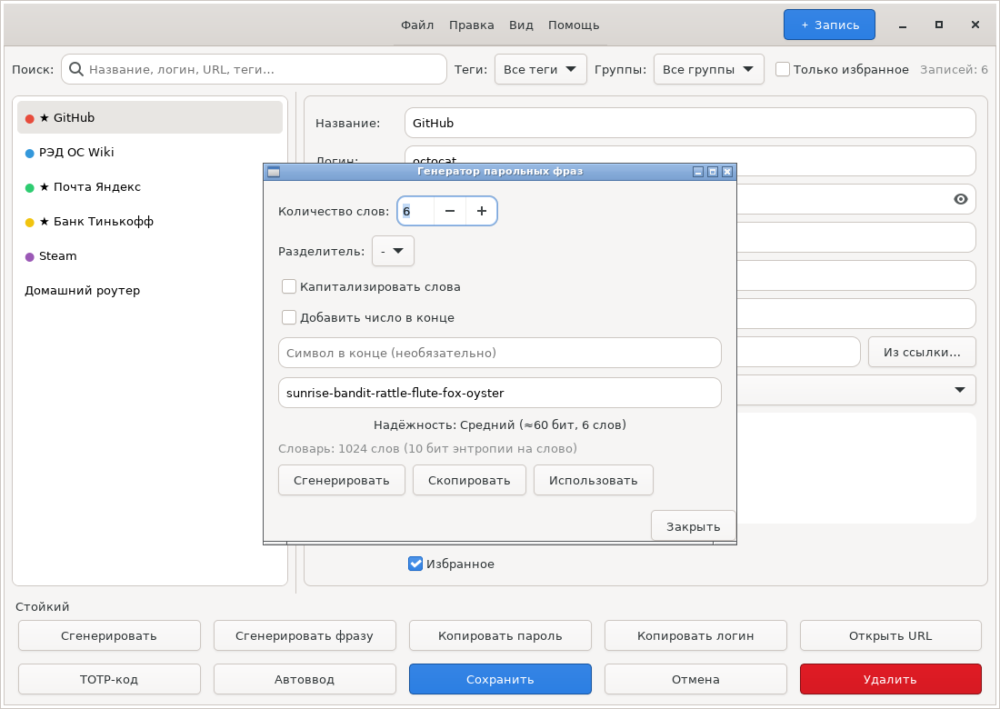
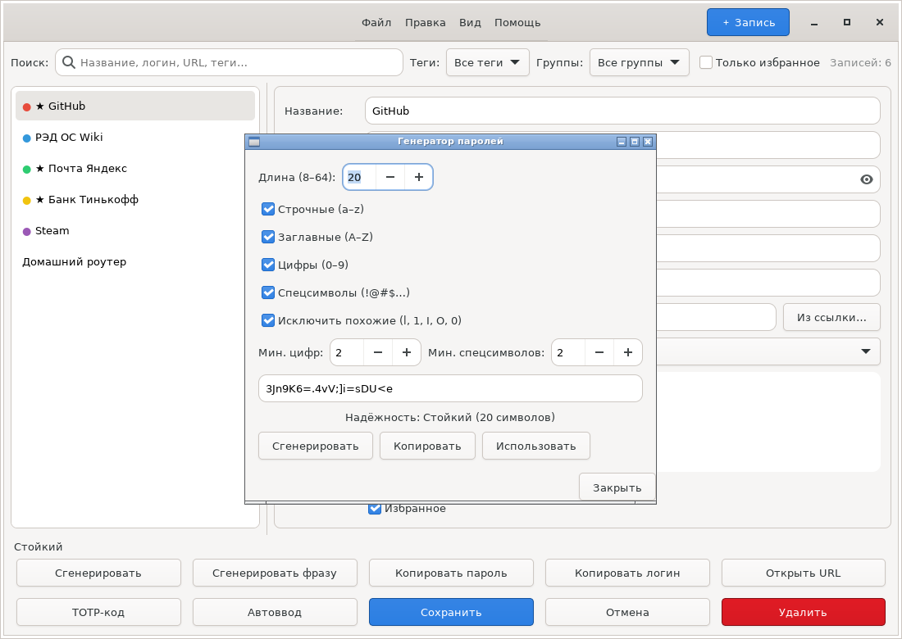
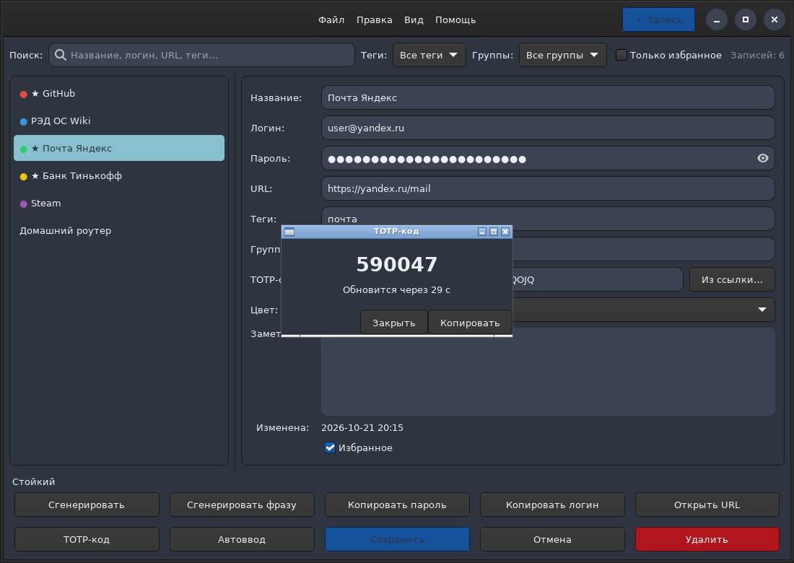
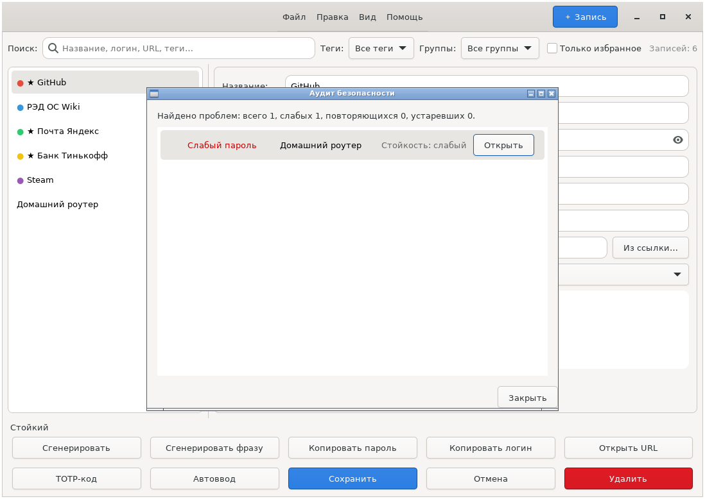
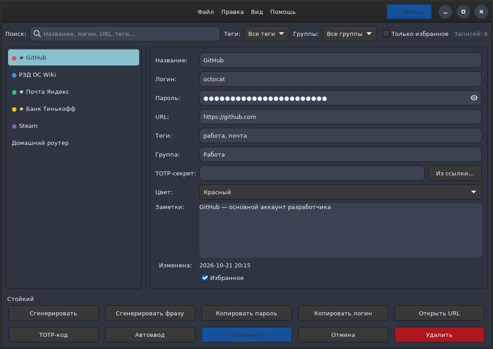

# Тайник — офлайн-менеджер паролей

[](https://github.com/flytimopheev-sketch/taynik/actions/workflows/ci.yml)
[](https://github.com/flytimopheev-sketch/taynik/releases/latest)
[](LICENSE)
[](https://www.rust-lang.org)
[](https://www.redos.ru)

**Тайник** — GTK4-приложение на Rust для локального хранения, генерации и
использования паролей. Работает полностью офлайн: без облака, сети и телеметрии.

- 🔐 Шифрование **AES-256-GCM**, ключ — **Argon2id** (64 МиБ, 3 итерации)
- 🧩 Привязка каждого шифротекста к имени поля (защита от подмены)
- 🔑 TOTP (RFC 6238) с импортом ссылок `otpauth://`
- 🧬 Генератор паролей **и запоминаемых парольных фраз** (diceware)
- 🩺 **Аудит безопасности**: слабые, повторяющиеся и устаревшие пароли
- 📦 Зашифрованный экспорт/импорт `.taynik` — перенос данных без открытого текста
- ⌨️ Автоввод в другие приложения (`xdotool` / `wtype`)
- 🎨 Тёмная, светлая, Nord, Dracula, Solarized

---

## Содержание

- [Скриншоты](#скриншоты)
- [Безопасность](#безопасность)
- [Функции](#функции)
- [Горячие клавиши](#горячие-клавиши)
- [Сборка из исходников](#сборка-из-исходников)
- [Установка](#установка)
- [Формат базы](#формат-базы)
- [Архитектура](#архитектура)
- [Разработка](#разработка)
- [Лицензия](#лицензия)

---

## Скриншоты

### Главное окно



Список записей с цветовыми метками и избранным, поиск, фильтры по тегам и
группам, счётчик записей. Кнопки действий вынесены в нижнюю панель и всегда
остаются на виду.

### Запись



Название, логин, пароль, URL, теги, группа, цветовая метка, TOTP-секрет и
заметки — всё в одной панели.

### Генератор парольных фраз



Фраза из слов словаря на 1024 слова: 6 слов ≈ 60 бит энтропии. Разделитель,
капитализация и добавление числа настраиваются.

### Генератор паролей



Длина 8–64, наборы символов, минимум цифр и спецсимволов, индикатор стойкости.

### TOTP-код



Двухфакторный код с обратным отсчётом и копированием в буфер обмена.

### Аудит безопасности



Слабые, повторяющиеся и устаревшие пароли — с возможностью сразу открыть
проблемную запись.

### Тёмная тема



Помимо системной есть светлая, тёмная, Nord, Dracula, Solarized Light и
Solarized Dark.

---

## Безопасность

- Устройство `.rpwm` — SQLite-файл; все чувствительные поля (название, логин,
  пароль, URL, заметки, теги, группа, цвет, TOTP-секрет) хранятся зашифрованными
  BLOB (AES-256-GCM, уникальный 12-байтовый nonce на поле, формат
  `nonce || ciphertext || tag`).
- Ключ шифрования выводится из мастер-пароля через **Argon2id**:
  память 64 МиБ, 3 итерации, parallelism 4, 32 байта.
- В базе хранятся только соль и параметры Argon2 (таблица `meta`); вместо
  мастер-пароля хранится зашифрованный «verifier» для проверки пароля.
- Каждое поле привязано к своему имени через AAD (дополнительные
  аутентифицируемые данные). Это не даёт злоумышленнику, получившему доступ к
  файлу базы, переставить шифротексты между столбцами — например подставить
  шифротекст пароля в столбец «название». Базы, созданные версиями до 1.2.0,
  читаются как обычно и автоматически переводятся на новый формат при первом
  открытии.
- Ключ очищается из памяти (zeroize); копия мастер-пароля, переданная в KDF,
  тоже обнуляется сразу после использования.
- Автоматическая блокировка по таймеру бездействия и (опционально) при
  сворачивании окна.
- Буфер обмена автоматически очищается через N секунд (по умолчанию 45).
- Экспорт в CSV хранит пароли **в открытом виде** — приложение предупреждает об
  этом. Для безопасного переноса данных используйте формат `.taynik`.

## Функции

### Записи

- CRUD записей: название, логин, пароль, URL, теги, группа, заметки, цветовая
  метка, избранное.
- Поиск по названию, логину, URL, группе и тегам; фильтры по тегам и группам;
  фильтр «только избранное»; счётчик записей.
- Сортировка по названию или дате изменения.
- История паролей: прежний пароль сохраняется при смене, его можно скопировать
  или восстановить в форму.
- Открытие URL записи в браузере, копирование логина/пароля/TOTP-кода.

### Генераторы

- Генератор паролей: длина 8–64, наборы символов, исключение похожих символов
  (`l 1 I O 0`), минимум цифр и спецсимволов, индикатор стойкости.
- Генератор **парольных фраз** (diceware): 3–12 слов из встроенного словаря на
  1024 слова (10 бит энтропии на слово), разделитель, капитализация, добавление
  числа и символа в конце. Фразу легко запомнить и продиктовать.

### Двухфакторная аутентификация

- TOTP по RFC 6238: SHA-1 и SHA-256, 6 или 8 цифр, произвольный период.
- Импорт секрета из ссылки `otpauth://totp/…` — вместе с издателем, алгоритмом
  и параметрами.

### Аудит безопасности

- Поиск **слабых** паролей (по эвристике длины и разнообразия символов).
- Поиск **повторяющихся** паролей — один и тот же пароль в нескольких записях.
- Поиск **устаревших** паролей (не менялись больше года).
- Каждая проблема открывается прямо в записи.

### Перенос данных

- Экспорт/импорт CSV (для совместимости; пароли в открытом виде).
- Экспорт/импорт в **зашифрованный** формат `.taynik`: содержимое шифруется
  AES-256-GCM ключом из отдельного пароля, в файле нет открытого текста.
- Резервные копии базы (`-backup-YYYYMMDD-HHMMSS.rpwm`) — согласованный
  снимок через `VACUUM INTO`.

### Прочее

- Автоблокировка, очистка буфера обмена, блокировка при сворачивании — в
  диалоге настроек.
- Автоввод в другие приложения по настраиваемой последовательности:
  `{USERNAME}`, `{PASSWORD}`, `{TAB}`, `{ENTER}`, `{DELAY мс}`.
- Темы оформления: система, светлая, тёмная, Nord, Dracula, Solarized.

## Горячие клавиши

| Комбинация | Действие |
|------------|----------|
| `Ctrl+N` | Новая запись |
| `Ctrl+F` | Фокус на поиск |
| `Ctrl+Q` | Выход |
| `Ctrl+L` | Заблокировать (закрыть базу) |
| `Ctrl+Shift+V` | Автоввод логина и пароля в активное окно |
| `Ctrl+Shift+C` | Скопировать логин |
| `Ctrl+Shift+P` | Скопировать пароль |

## Сборка из исходников

Требуется Rust (stable) и GTK4 ≥ 4.10:

```bash
cargo build --release
./target/release/taynik
```

Все зависимости вендорены в каталоге `vendor/` (см. `.cargo/config.toml`),
поэтому сборка не требует доступа к сети к crates.io.

## Установка

### RPM для РЕД ОС 7/8

Готовый RPM собирается автоматически в GitHub Actions и публикуется в разделе
[Releases](https://github.com/flytimopheev-sketch/taynik/releases) на тегах `v*`.

```bash
sudo dnf install ./taynik-1.2.0-1.*.rpm
```

Устанавливаются: `/usr/bin/taynik`, `/usr/share/applications/taynik.desktop`,
`/usr/share/icons/hicolor/scalable/apps/taynik.svg`,
`/usr/share/metainfo/taynik.metainfo.xml`.

### Сборка RPM вручную

```bash
rpmbuild -bb packaging/taynik.spec
sudo dnf install ~/rpmbuild/RPMS/x86_64/taynik-1.2.0-1.*.rpm
```

Сборка выполняется через `cargo-zigbuild` с целевой glibc 2.17, чтобы бинарник
работал на РЕД ОС 7/8 и новее.

### Установка на машину без интернета

На машине с интернетом (один раз):

```bash
./packaging/make-source-tarball.sh
mkdir -p ~/rpmbuild/SOURCES
cp taynik-1.2.0.tar.gz ~/rpmbuild/SOURCES/
```

Перенести каталог `rpmbuild` на офлайн-машину, затем:

```bash
rpmbuild -bb packaging/taynik.spec
sudo dnf install ~/rpmbuild/RPMS/x86_64/taynik-1.2.0-1.*.rpm
```

Нужны только пакеты `rust`, `cargo`, `gcc`, `pkgconfig` и `gtk4-devel` —
они берутся из локального репозитория РЕД ОС / установочного носителя.

При необходимости обновить вендор: `cargo vendor vendor` (на машине
с интернетом), следуя выводимой инструкции для `.cargo/config.toml`.

## Формат базы

Файл `.rpwm` — это SQLite-база с таблицами:

| Таблица | Содержимое |
|---------|-----------|
| `meta` | соль и параметры Argon2, verifier, версия схемы и формата шифрования |
| `entries` | записи; все значимые поля — зашифрованные BLOB |
| `entry_history` | прежние пароли записей (тоже зашифрованы) |

Версия схемы хранится в `meta`; при открытии базы автоматически добавляются
отсутствующие столбцы и обновляется формат шифрования. Никаких действий от
пользователя не требуется.

## Архитектура

```
src/
  main.rs          точка входа
  config.rs        настройки (~/.config/taynik/config.toml)
  db/
    crypto.rs      Argon2id + AES-256-GCM (+ AAD)
    schema.rs      схема БД и миграции
    repository.rs  открытие/создание базы, CRUD, смена мастер-пароля
    io.rs          импорт/экспорт CSV
    transfer.rs    зашифрованный экспорт/импорт (.taynik)
  models/
    entry.rs       запись
    generator.rs   генератор паролей и оценка стойкости
    passphrase.rs  генератор парольных фраз (diceware)
    totp.rs        TOTP (RFC 6238), SHA-1/SHA-256, разбор otpauth://
    audit.rs       аудит безопасности
  ui/
    start_window.rs, unlock_dialog.rs, create_db_dialog.rs, main_window.rs,
    password_generator.rs, passphrase_dialog.rs, audit_dialog.rs,
    settings_dialog.rs, autotype.rs, theme.rs
packaging/         taynik.spec (RPM), desktop/metainfo, make-source-tarball.sh
resources/         иконка, словарь для генератора фраз
docs/               ARCHITECTURE.md
vendor/            вендоренные Rust-зависимости (сборка без интернета)
```

Подробнее — в [docs/ARCHITECTURE.md](docs/ARCHITECTURE.md).

## Разработка

```bash
cargo fmt --check          # форматирование
cargo clippy --all-targets # статический анализ
cargo test                 # модульные тесты
```

Полный список команд — в [CONTRIBUTING.md](CONTRIBUTING.md).
Все проверки запускаются в CI: [.github/workflows/ci.yml](.github/workflows/ci.yml).

## Лицензия

[MIT](LICENSE) © 2026 flytimopheev@gmail.com
